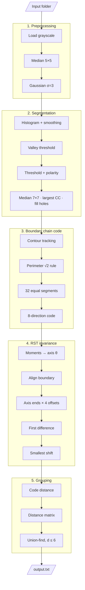

# Machine Vision – Final Assignment

**Grouping objects by RST-invariant chain codes**

`pipeline.py` loads every `.png` / `.jpg` image in a folder, removes noise, segments the single object in each image, describes its boundary with a 32-digit chain code, makes that code invariant to **rotation, scaling, translation (RST) and starting point**, groups images whose objects have the same shape, and writes the groups to a text file.

**Rule followed:** OpenCV is used **only to load images** (`cv2.imread`). Every other operation (filtering, thresholding, contour tracking, chain coding, moments, grouping) is implemented from scratch with NumPy, one function per operation.

---

## Quick start

Run the commands from the `Final_assignment/` folder (not from `doc/`).

```bash
pip install numpy matplotlib opencv-python
python pipeline.py Samples                  # writes output.txt
python pipeline.py Samples --debug          # also saves figures to ./debug
python sample_grid.py Samples               # all sample images in one 4×3 figure
```

| Option | Default | Meaning |
|---|---|---|
| `input_folder` | (required) | folder with the `.png` / `.jpg` images |
| `--output` | `output.txt` | text file for the groups and codes |
| `--threshold` | `6` | maximum chain-code distance for two images to be in the same group |
| `--debug` | off | save intermediate figures to `./debug/` |

Runtime: about 48 s for the 12 sample images (most of it is region growing in Step 2).

## Folder layout

```
Final_assignment/
├── pipeline.py                 ← the pipeline (all source code)
├── sample_grid.py              ← helper: saves all sample images in one 4×3 figure
├── output.txt                  ← result: image groups + invariant chain codes
├── samples_grid.png            ← output of sample_grid.py
├── Samples/                    ← sample images im-1.png … im-12.png
├── debug/                      ← created with --debug (see "Debug output")
└── doc/
    ├── README.md               ← this file
    ├── Report.pdf              ← assignment report
    ├── pipeline_diagram.drawio ← pipeline diagram (open in draw.io / diagrams.net)
    └── Task.txt                ← assignment brief
```

`sample_grid.py` imports `load_images()` from `pipeline.py`, so it must stay in the same folder.

---

## Pipeline overview



The editable version of this diagram is `pipeline_diagram.drawio`.

| Stage | Input | Output |
|---|---|---|
| 1. Preprocessing | image file | denoised grey image |
| 2. Segmentation | denoised image | binary object mask (object = 1) |
| 3. Boundary chain code | mask | ordered boundary pixels + raw 32-digit chain code |
| 4. RST invariance | mask + boundary | 8 invariant candidate codes (+ 1 canonical code) |
| 5. Grouping | candidate codes of all images | groups → `output.txt` |

---

## Stage 1: Preprocessing (Unit 4, noise filtering)

| Function | What it does |
|---|---|
| `load_images()` | reads every `.png` / `.jpg` as grayscale (`cv2.IMREAD_GRAYSCALE`), sorted naturally (im-2 before im-10) |
| `pad_image()` | replicates edge pixels so a filter window fits at the borders |
| `convolve2d()` | 2-D convolution as a weighted sum of shifted image copies |
| `median_filter()` | median of each k×k window: removes **outlier (salt & pepper / star)** noise without blurring edges |
| `gaussian_kernel_1d()`, `gaussian_kernel_size()` | Gaussian weights; size = 2·⌈3σ⌉ + 1 so the kernel covers ±3σ |
| `gaussian_filter()` | separable Gaussian smoothing (row pass + column pass): removes **Gaussian** noise |
| `reduce_noise()` | median 5×5 **first** (so outliers aren't smeared), then Gaussian σ = 3 |

**Why such strong smoothing (σ = 3, 19×19)?** Only the object's silhouette is needed. Strong smoothing removes the surface texture (dark craters, grainy blobs) that would otherwise leave holes and specks after thresholding, while the outline barely moves (the threshold changed only from 29 to 26 between no smoothing and σ = 3).

## Stage 2: Segmentation (Unit 6, thresholding and region processing)

| Function | What it does |
|---|---|
| `compute_histogram()` | h(i) = number of pixels with grey level i |
| `smooth_histogram()` | h(i) = AVE(h(i−4) … h(i+4)), applied twice, to remove false peaks and valleys |
| `valley_threshold()` | starts at the largest peak (background) and walks towards the side with **more pixels** (the object) until the histogram rises again: that valley is T |
| `inter_means_threshold()` | fallback when there is no valley: iterate T = (μ₁ + μ₂) / 2 until the means converge |
| `threshold_image()` | g = 1 if f > T; flips the result if the image border is mostly 1 (dark object on a bright background) |
| `connected_components()` | 8-connected component labelling by region growing |
| `largest_component()` | keeps only the biggest region (removes leftover stars) |
| `fill_holes()` | grows the background (4-connected) from the image border; unreached pixels are holes and are filled |
| `segment_object()` | histogram → valley T → binary → median 7×7 → largest component → fill holes |

**Why the valley method instead of inter-means?** On the asteroid images the background is a narrow peak near 0 and the object is spread over 30–200. Inter-means (and Otsu) put T midway between the class means (T ≈ 69), which cut off the shadowed side. The valley method picks T = 23, right after the background peak.

**Why smooth the histogram twice?** The valley walk stops at the first dip, so every false dip left by noise is a chance to stop too early. The number of local minima on the samples:

| Image | No smoothing | 1 pass | 2 passes |
|---|---|---|---|
| im-1 | 48 (T = 19) | 4 (T = 23) | 3 (T = 23) |
| im-8 | 25 (T = 97) | 9 (T = 98) | 2 (T = 99) |
| im-12 | 38 (T = 92) | 8 (T = 103) | 2 (T = 103) |

Without smoothing the walk stops inside the background slope (im-12: T = 92). Two passes of the 9-wide average act like one gentler, bell-shaped smoothing and leave only the real valleys.

**Why both largest component and fill holes?** They fix opposite errors. `largest_component()` removes extra **1s outside** the object (stars, specks); it only removes pixels, so it cannot close a hole. `fill_holes()` sets the missing **0s inside** the object (dark craters below T) to 1. After largest component, im-1 still has 22 holes (2 839 pixels). The outline is the same either way, but Stage 4 computes moments from the whole mask: the holes tilt the major axis from 44.15° to 43.22° and change a digit of the invariant code. Filling them makes the moments depend only on the outline.

## Stage 3: Boundary chain code (Unit 6 contour tracking, Unit 7 chain codes)

| Function | What it does |
|---|---|
| `trace_contour()` | contour tracking: start at the top-left object pixel, search from m = (n − 2) mod 8, stop when back at the start; returns the boundary pixels in clockwise order |
| `direction_code()` | Freeman 8-direction code of a vector (0 = East, anticlockwise in 45° steps) |
| `pixel_chain_code()` | Method 1: one code per pixel step |
| `cumulative_perimeter()` | running boundary length: even codes add 1, odd (diagonal) codes add √2 |
| `subdivide_boundary()` | Method 3: cut the boundary into **32 equal-length** segments (optionally from a given start length) |
| `segment_chain_code()` | direction of the straight chord of each segment → 32 digits |
| `boundary_chain_code()` | mask → boundary → 32 segments → raw chain code; computes the perimeter once and passes it on |

The raw code is already **translation invariant** (it stores only directions) and **scale invariant** (always 32 equal segments). im-3 and the half-size im-5 give the same raw code.

## Stage 4: RST invariance (Unit 7, chain-code normalisation and image moments)

| Function | What it does |
|---|---|
| `raw_moment()` | m_pq = Σ xᵖ yᵠ over the object pixels |
| `central_moments()` | centroid (m₁₀/m₀₀, m₀₁/m₀₀) and μ₂₀, μ₀₂, μ₁₁ about the centroid |
| `principal_axis_angle()` | major-axis orientation θ = ½·atan2(2μ₁₁, μ₂₀ − μ₀₂) |
| `align_boundary()` | moves the centroid to (0, 0) and rotates the boundary **points** by −θ, so the major axis lies along x |
| `major_axis_ends()` | the two boundary pixels at the ends of the major axis (start points that move with the shape) |
| `first_difference()` | **rotation**: C′ᵢ = (Cᵢ − Cᵢ₋₁) mod 8 (circular) |
| `normalize_start_point()` | **starting point**: the circular shift that forms the smallest integer |
| `invariant_chain_codes()` | for 2 axis ends × 4 offsets (0, ¼, ½, ¾ of a segment): cut, code on the aligned boundary, first difference, smallest shift → **8 candidate codes** |
| `canonical_code()` | the smallest candidate, printed as the image's invariant code |

**Why more than the lecture's two normalisations?** The first difference assumes that rotating a shape adds the same constant to every direction digit. The lecture notes say the normalisations are exact only if the boundary itself is unchanged by rotation, and on a pixel grid it is not:

1. Pixels can only step in 8 directions, so a rotated straight edge becomes a different staircase (`0 0 0 0` at 0°, `0 0 1 0 0 1` at 20°), not the same steps relabelled.
2. A rotated image is resampled onto the grid, so its jagged edge and even its boundary length change.
3. Chord directions are rounded to 45°, so a 1° rotation can flip a digit (22° → 0, 23° → 1).
4. The 32 cuts start at the top-most pixel, which is a different part of a rotated shape, so the chords join different points.

Only multiples of 90° keep the pixel outline exact. With only the first difference and the smallest shift, im-1 (im-3 rotated by 180°) was 18 away from im-3, as far as an unrelated shape, and rotated copies of im-3 were 12–20 away.

**The fix: a standard pose before the lecture normalisations.**

| Problem | Handled by |
|---|---|
| 45° rounding (3) | aligning the boundary to the major axis first, so every copy is coded in the same direction |
| cut positions depend on the start (4) | starting at the major-axis ends, which move with the shape |
| start pixel moves 1–2 px with noise | 4 offsets inside the first segment |
| the axis has no front (180° left over) | first difference (lecture) |
| where the code starts reading | smallest circular shift (lecture) |
| remaining staircase differences (1, 2) | the distance threshold in Stage 5 |

On 39 synthetically rotated and scaled copies of im-3, the candidate sets always shared an identical code (distance 0). The result is not exact for every image, but it is close enough that the small leftover differences (0–8 within the asteroid group) stay below the grouping threshold.

| Invariance | Achieved by |
|---|---|
| Translation | directions only + central moments |
| Scale | 32 equal-length segments |
| Rotation | major-axis alignment + first difference |
| Starting point | axis-end start + offsets + smallest circular shift |

## Stage 5: Grouping

| Function | What it does |
|---|---|
| `digit_difference()` | circular digit difference min(\|a − b\|, 8 − \|a − b\|), from 0 to 4 |
| `code_distance()` | sum of digit differences at the best of the 32 circular alignments |
| `chain_code_distance()` | distance between two images = closest pair among their 8 × 8 candidates |
| `distance_matrix()` | 12 × 12 table of all pairwise distances |
| `find_root()`, `group_images()` | links images with distance ≤ threshold; groups are the connected components (union-find) |
| `write_output()` | writes the groups and the canonical codes to the output file |

**Threshold = 6.** Every threshold from 4 to 8 gives the same groups. Below 4, rotated copies (im-6, im-7) split off; from 10, unrelated shapes merge. 6 is the middle of that stable range.

---

## Results (sample images)

```
Group 1: im-1.png, im-3.png, im-4.png, im-5.png, im-6.png, im-7.png
Group 2: im-2.png
Group 3: im-8.png
Group 4: im-9.png
Group 5: im-10.png
Group 6: im-11.png
Group 7: im-12.png
```

- **Group 1:** the same asteroid; im-1 is rotated 180°, im-5 and im-6 are scaled/rotated, im-7 is stretched.
- **im-2:** a **mirror image** of im-1. A reflection is not part of RST, and mirror invariance is not in the lecture notes, so it is kept as its own group.
- **im-8 … im-12:** five different blob shapes (pairwise distances 12–18).

The full list of invariant codes is in `output.txt`. The full write-up, with pseudo code for every algorithm and the debug figures, is in `doc/Report.pdf`.

## Sample overview (`sample_grid.py`)

| Function | What it does |
|---|---|
| `save_sample_grid()` | draws up to 12 images in a 4 × 3 grid, each titled with its file name, and saves the figure |

It loads the images with `load_images()` from `pipeline.py` (OpenCV used only to read the files). Use `--output name.png` to change the output file (default `samples_grid.png`).

## Debug output (`--debug`)

| File | Content |
|---|---|
| `debug/histograms.png` | all histograms with the selected threshold (4 per row) |
| `debug/chain_codes.png` | traced boundaries, the 32 segments and the raw codes |
| `debug/aligned.png` | boundaries after major-axis alignment, with start points and invariant codes |
| `debug/distance_matrix.png` | heat map of all pairwise distances; red = within the threshold |
| `debug/stages/<name>_stages.png` | original, denoised, thresholded and final mask for one image |
| `debug/histogram/<name>_histogram.png` | one image's histogram |
| `debug/chain_code/<name>_chain_code.png` | one image's boundary and raw chain code |
| `debug/aligned/<name>_aligned.png` | one image's aligned boundary and invariant code |

## Limitations

- **Valley direction:** assumes the object's pixels lie on the side of the background peak that holds more pixels.
- **Polarity check:** assumes the object covers less than half of the image border.
- **Contour stop rule:** "stop when the start is reached" can end early on one-pixel-wide spurs (the 7×7 binary median removes them here).
- **Near-round shapes:** the major axis is less reliable (the asteroid's long axis is only about 14% longer than its short axis); the 4 offsets compensate.
- **Mirror images** are not matched (im-2).
- **Non-uniform stretching** (im-7) is not RST; it still groups because the distortion is small.
- **Single-linkage chaining:** images can join a group through an intermediate image (im-6 and im-7 are 8 apart but both close to im-5).

## Lecture-notes mapping

| Pipeline part | Lecture source |
|---|---|
| Median and Gaussian filters | Unit 4, Noise filtering |
| Histogram smoothing, valley, inter-means, thresholding | Unit 6, Segmentation |
| Region growing, connected component labelling | Unit 6, Segmentation |
| Contour tracking | Unit 6, Segmentation |
| Chain codes (Methods 1 and 3), perimeter from chain code | Unit 7, Representation |
| First difference, smallest-integer start, size normalisation | Unit 7, Chain-code normalisation |
| Image moments, centroid, central moments | Unit 7, Image moments |
| Major-axis alignment, axis-end start points, offsets | additions built on Unit 7 (not on the slides) |
